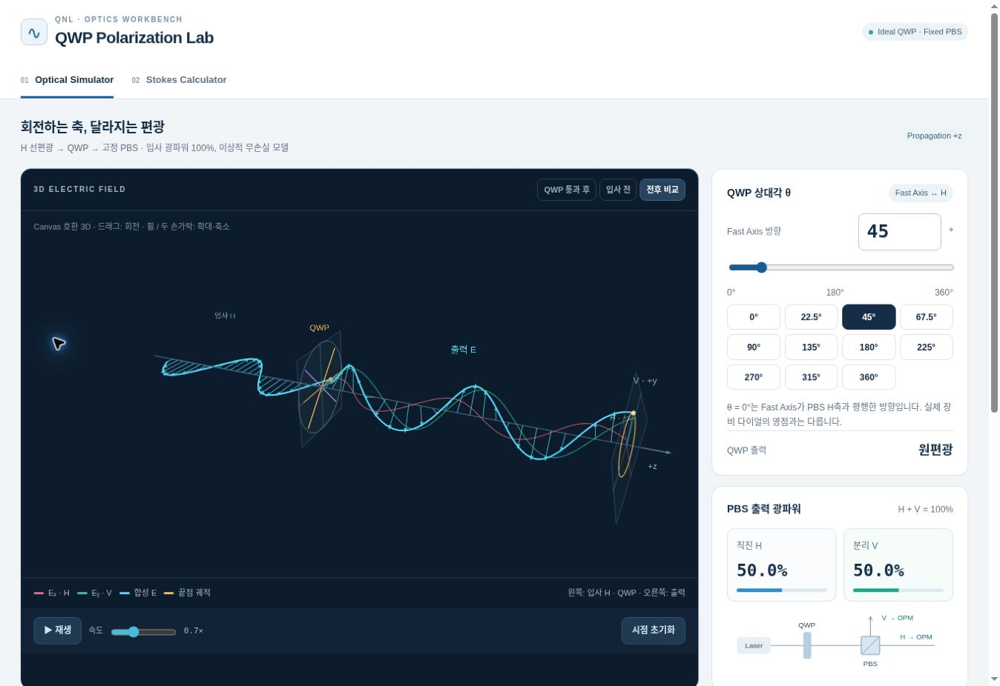

# QWP Polarization Lab

Laser → Rotating QWP → Fixed PBS → Optical Power Meter 실험을 위한 단일 HTML 앱입니다.

`index.html`을 다운로드해 브라우저에서 열면 실행됩니다. 빌드, 백엔드, 별도 앱 파일은 필요 없습니다. 3D 라이브러리는 인터넷 연결이 필요하며 측정 데이터는 브라우저 안에서만 처리됩니다. GitHub Pages를 사용하는 경우 루트의 `index.html`을 그대로 제공하면 됩니다.



## 기능

- **Optical Simulator:** 고정 H 입사광, QWP 0–360° 다이얼/숫자/프리셋, Ex/Ey/합성 E의 3D 전파, 전기장 화살표, 끝단 궤적, 전후 비교, 카메라 회전·확대, 재생·정지·속도.
- **축과 파워:** Fast/Slow 성분의 90° 위상차, 2D 편광 타원, PBS H/V 파워 막대 및 각도 그래프. 2D 출력 벡터의 위상은 3D 끝단과 일치합니다.
- **Stokes Calculator:** 독립 탭, 큰 모바일 숫자 입력, 다음 필드 이동, 기본 4각도 공식 및 임의 추가각의 QR 최소제곱 추정.
- **보정:** 기준 다이얼 θ₀, A/B→H/V 매핑, 양수 상대 검출 효율, μW/mW 환산, 원편광 부호 선택.
- **보존:** 로컬 자동 저장/복원, 전체 초기화, 설정을 포함한 CSV 왕복, 결과와 측정값 복사. 저장 또는 클립보드가 제한된 브라우저에는 대체 안내를 표시합니다.
- **실패 처리:** CDN 실패 안내 및 재시도. WebGL 컨텍스트가 없는 기기에는 동일한 Three.js scene/camera/geometry를 Canvas 2D로 투영하는 3D 호환 렌더러를 사용합니다.

모바일의 첫 실행은 계산기 탭으로 시작하고 이후에는 마지막 사용 탭을 복원합니다. 시뮬레이터를 열기 전에는 3D CDN을 로딩하지 않습니다. 추가 분석 기능, HWP, 자유 셋업, Bloch/Poincaré 구는 포함하지 않습니다.

## 물리 관례

+z 진행, H=+x, V=+y, θ는 Fast Axis의 x→y 상대각입니다. 실제 장비의 다이얼 영점과 구별합니다.

```
E(z,t) = Re[J exp(i(kz − ωt))]
f = (cosθ, sinθ), q = (−sinθ, cosθ)
J_QWP = f fᵀ + i q qᵀ
s1 = (|Ex|² − |Ey|²) / S0
s2 = 2 Re(Ex* Ey) / S0
s3 = 2 Im(Ex* Ey) / S0
```

Slow 성분의 +π/2 공간 위상은 이 시간 관례에서 시간적 ¼주기 지연입니다. (1,+i)/√2 ↔ s3=+1이고 (1,−i)/√2 ↔ s3=−1입니다. R/L 명칭은 관측 방향·분야에 따라 달라 여기서는 부호와 Jones 벡터를 직접 표시합니다.

고정 H 입사광의 QWP 출력:

```
Jout = (cos²θ + i sin²θ, sinθ cosθ(1−i))ᵀ
PH = 1 − ½ sin²(2θ), PV = ½ sin²(2θ)
```

계산기에서 보정된 파워를 사용하는 분석식:

```
PA_corr = PA / ηA, PB_corr = PB / ηB → H/V 매핑
d(θ) = (PH − PV) / (PH + PV)
d(θ) = cos²(2θ)s1 + ½sin(4θ)s2 + sin(2θ)s3
s1 = d(0°), s2 = d(22.5°) − d(67.5°), s3 = d(45°)
```

반대 부호 관례에서는 s3와 분석식의 s3 계수가 함께 반전됩니다. θ=45°에서 H를 넣은 **출력**의 s3=−1인 것과 계산기의 d(45°)가 **입사광** s3를 읽는 것은 양립합니다.

S0는 사용한 각도들의 보정 포트 합 평균이며 Si=S0·si입니다. 절대 입사 파워로 해석하려면 효율과 전체 손실의 절대 보정이 필요합니다. DOP>1은 제한하지 않고 경고합니다. 부분 편광 타원은 편광 성분만 정규화하며 무편광 배경을 표현하지 않습니다.

최소제곱은 정규화 차이를 동일 가중치로 추정합니다. 재직교화 QR로 풀고, 독립 정보 부족 또는 조건수 >10⁶이면 결과를 내지 않습니다. 조건수 >100, 잔차 RMS >0.02, 포트 합 변동 >5%는 경고합니다. 분류 허용오차 0.02는 실측 불확도 추정이 아닙니다.

## QNL에서 재사용한 부분

원본: [unpairedspin/QNL/index.html](https://github.com/unpairedspin/QNL/blob/main/index.html), 확인한 blob SHA `9eda82cef29bde39730ce4cbe44839813438c305`.

- **계승/수정:** PerspectiveCamera와 감쇠 OrbitControls, BufferGeometry의 Ex/Ey/합성 E 배열 갱신, z축 ArrowHelper 벡터, 고정 끝단 LineLoop 궤적, 성분별 색상.
- **수정:** 원본의 화살표 z 위치와 파형 샘플 위치 불일치를 해소하고 실제 프레임 시간으로 애니메이션 속도를 계산합니다. 30fps 상한, DPR 상한, 비활성 탭 중단, ResizeObserver를 적용합니다.
- **신규:** 복소 Jones QWP, 무손실 PBS 계산, 전후 비교, Fast/Slow 도해, 계산기·QR·조건수·보정·CSV·저장, 모바일 UI, Canvas 호환 3D.

Three.js와 OrbitControls는 모두 **0.128.0 / r128**로 고정했습니다. 두 CDN은 같은 버전의 대체 경로이며 서로 다른 버전을 혼용하지 않습니다. CSS와 2D 그래프, 계산기는 외부 의존성이 없습니다.

분석 모델 참고: [Sparks, Germer & Sparks, Classical polarimetry with a twist (2019)](https://pmc.ncbi.nlm.nih.gov/articles/PMC6774357/). 최종 부호는 위 Jones 모델에서 독립적으로 유도·검증했습니다.

## 검증 (2026-11-03)

`node tests/verify.mjs` — 의존성 설치 없이 실행:

- 1,179개 물리 검증: PBS 기준 5각도, 180° 주기, 다양한 복소 Jones 상태와 분석식 일치, 4각도 역산, QR 추정, 순위 부족·불량 조건수 거부, s3 부호.
- 데이터 검증: CSV 왕복과 잘못된 형식 거부, 영점·매핑·효율 보정, 숫자 검증, 음수/0 합 거부, DOP 비제한.

실제 Chrome 브라우저에서 확인:

| 항목 | 결과 |
| --- | --- |
| QWP 0°,22.5°,45°,67.5°,90° H/V | 100/0, 75/25, 50/50, 75/25, 100/0% |
| H, D, ±원편광 | (1,0,0), (0,1,0), (0,0,±1) |
| 타원편광 | (0.36,0.48,0.80), DOP=1 |
| θ₀=350°, A=V/B=H, ηA=.8, ηB=.6 | 같은 보정 벡터, 다이얼 350°,12.5°,35°,57.5° |
| 추가 다이얼 121° → 상대각 131° | 5행 최소제곱 일치 |
| 반대 부호·μW→mW | s3만 반전, S0=100μW→0.1mW |
| CSV 다운로드→초기화→파일 가져오기 | 5행과 설정 전부 복원 |
| 새로고침·결과 복사 | 복원 및 실제 클립보드 텍스트 확인 |
| 0°,90°,180°만 유효한 측정 | 독립 정보 부족 경고, 수치 미출력 |
| 비물리적 입력 | DOP=2.4495 그대로 표시 + 경고 |
| 390×844 iframe 모바일 레이아웃 | 첫 실행 계산기, 입력 시작·Enter 다음 필드, clientWidth=scrollWidth=375 (스크롤바 제외) |
| 3D 상호작용 | 카메라 드래그·휠 줌, 프레임 변화, 재생·정지, 전후 비교 |
| 고의로 CDN 경로를 깨뜨린 QA 페이지 | 명확한 실패 안내, 계산기 정상 사용 |

**검증 한계:** 테스트용 클라우드 Chrome에서 WebGL 컨텍스트 생성이 지원되지 않아 위 3D 동작과 스크린샷은 Canvas 호환 경로로 확인했습니다. 정상 WebGL 경로의 실제 GPU 렌더링과 iOS/Android 실기기 키패드·터치 제스처는 이 환경에서 직접 검증하지 못했습니다. 모바일 폭과 inputmode=decimal, 필드 이동은 브라우저에서 확인했습니다.

실행 앱은 `index.html` 하나입니다. `tests/`, `docs/`, 이 README는 실행에 필요하지 않습니다. 브라우저에서 입력한 임시 측정값은 HTML에 내장하거나 GitHub에 올리지 않습니다. 테스트 스크립트에는 알려진 합성 편광 상태만 사용합니다.
